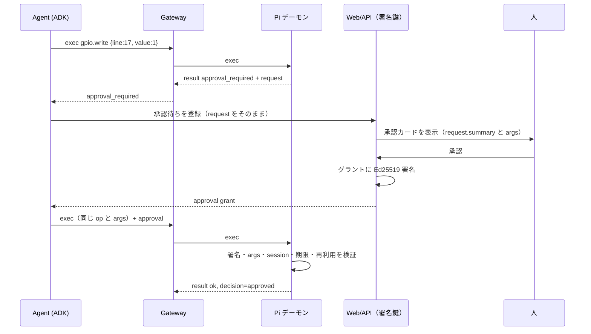
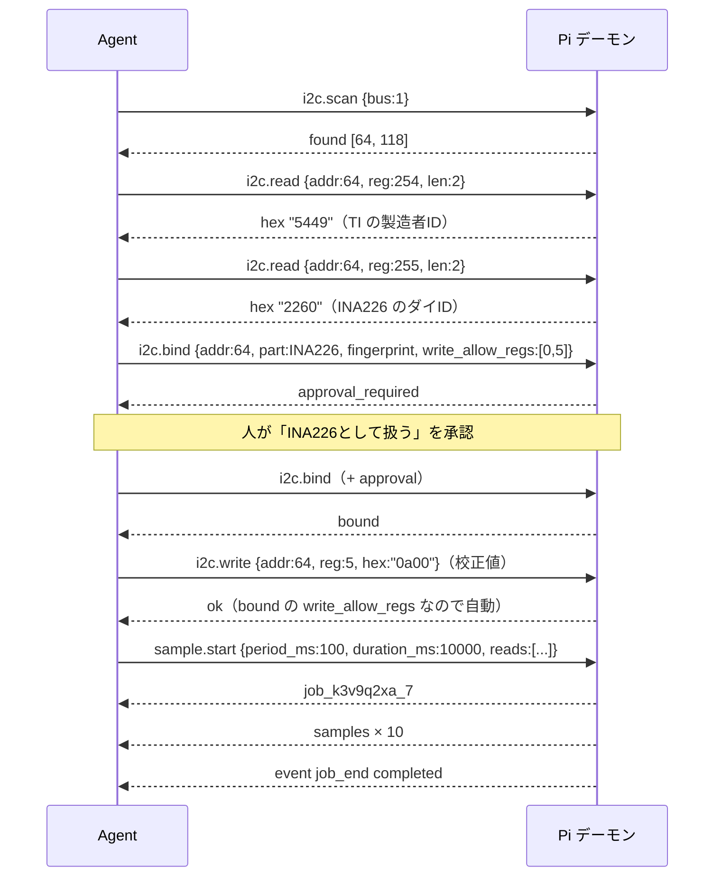

# むげむげ デバイスプロトコル v1

対象: Pi側デーモン `mugemuge-agentd` と Cloud Run 上の Device Gateway の間の通信
状態: ドラフト（2026-10-05、デーモン本体の実装に合わせて細部を追記）
関連: `schemas/manifest.schema.json`、`schemas/protocol.schema.json`、`examples/`

---

## 0. 設計の原則

1. **デバイスが最終判断者**。クラウドから来た要求は、デバイス上のマニフェストに照らしてデバイスが許可・保留・拒否を決める。クラウド側の事前チェック（ADKの `before_tool_callback`）は早期に弾くための写しにすぎない。
2. **既定は拒否**。マニフェストに書かれていないバス・アドレス・ピン・opはすべて拒否する。
3. **承認は「拒否」を覆せない**。人の承認で通せるのは `approval` レベルの操作だけで、`deny` はどの承認でも通らない。
4. **エージェントは承認を偽造できない**。承認はWeb/APIサービスだけが持つ鍵でEd25519署名され、デバイスが公開鍵で検証する。LLMが動くAgentサービスは署名鍵に触れない。
5. **デバイスはコードを実行しない**。デバイスが受け取るのは宣言的なop（「このレジスタを2バイト読む」）だけで、LLMが生成したコードは実行しない。値の換算（生バイト→物理量）はクラウドで行う。
6. **安全側への操作は常に通る**。出力を安全値に戻す、計測を止める、非常停止をかける、バインドを外す、は承認なしで常に許可する。
7. **マニフェストはリモートから変更できない**。マニフェストの変更は、Pi上でのファイル編集とデーモン再起動に限る。

## 1. 信頼モデル

| 想定する失敗・攻撃 | 守るもの | 結果 |
|---|---|---|
| LLMの判断ミス、プロンプトインジェクション | マニフェスト＋承認＋各種上限 | 許可範囲外の操作は `policy_denied`、要承認の操作は人が見るまで止まる |
| Agentサービスの侵害 | 署名鍵の分離 | 承認を作れないので、`allow` の範囲しか動かせない |
| Web/APIサービス（署名鍵）の侵害 | マニフェストの `deny`、各種上限、出力の時間上限、デッドマン | 承認は偽造されうるが、`deny` と物理的な上限は越えられない |
| 通信断・クラウド障害 | デッドマン | `deadman_ms` 以内に全出力が安全値へ戻り、計測ジョブが止まる。記録ジョブ（読み出しと撮影だけ）は止めずに Pi に貯め、つながったら送る（8.1・8.5節） |
| 計測中の部品の差し替え | 指紋レジスタの再確認 | 書き込み前に指紋が一致しなければ拒否し、バインドを解除する |
| Pi上のroot侵害、物理的な改造 | 対象外 | — |

## 2. 接続と認証

### 2.1 エンドポイント

```
wss://<gateway>/v1/device
Sec-WebSocket-Protocol: mugemuge.v1
Authorization: Bearer mgd_<token>
```

- 接続は**常にデバイスから**張る。デバイスは待ち受けポートを開けない。
- フレームはすべてUTF-8のJSONテキストフレーム。1フレーム1メッセージ、最大64KiB。
- デバイストークンはペアリング時に発行される32バイトの乱数。Gatewayはsha256だけを保存し、UIから失効できる。トークンが許すのはこのエンドポイントへの接続だけで、Agentや管理APIは呼べない。
- トークンファイルは `0600`、所有者はデーモン実行ユーザー。

### 2.2 ペアリング（初回のみ）

1. ログインしたユーザーがUIで「デバイスを追加」を押し、6桁のペアリングコード（有効10分）を得る
2. Pi上で `mugemuge-agentd pair <コード>` を実行する
3. デーモンが `POST https://<gateway>/v1/pair {"code": "...", "device_id": "<マニフェストのdevice.id>"}` を送り、`{"token": "mgd_..."}` を受け取ってトークンファイルに書く

### 2.3 再接続

- 切断されたら指数バックオフで再接続する（1, 2, 4, 8, 16, 30秒で頭打ち。各±20%のジッタ）
- Cloud Runはリクエスト時間に上限（最大60分）があるため、定期的な切断は正常系として扱う
- 再接続のたびに新しい `session_id` が払い出される。前のセッションの承認は無効になる

## 3. メッセージの共通形式

```json
{
  "v": 1,
  "type": "exec",
  "id": "01J9Z6Q3V8H4K2M7N5P0R1S2T3",
  "ts": 1759581000123
}
```

| フィールド | 型 | 説明 |
|---|---|---|
| `v` | 整数 | プロトコルのバージョン。v1では常に `1` |
| `type` | 文字列 | メッセージ種別（3章の表） |
| `id` | 文字列 | 送信側が採番する一意なID（ULID推奨、8〜64文字） |
| `ts` | 整数 | 送信時刻（UNIXミリ秒） |
| `re` | 文字列 | 応答の場合、元メッセージの `id` |

数値はすべて整数で表す（浮動小数点は使わない）。JSON Schema は `2.0` も整数とみなすため、受信側はJSONパーサの段階で小数表記・指数表記・`NaN` を拒否し、`bad_request` を返す（承認の `args_sha256` が一意に決まらなくなるのを防ぐ）。バイト列は小文字の16進文字列（例: `"5449"`）で表す。I2Cアドレスとレジスタは整数で、JSON上は10進になる（0x40 → `64`）。

## 4. メッセージ種別

| type | 向き | 役割 |
|---|---|---|
| `hello` | デバイス→クラウド | 接続直後に1回。デバイスID、マニフェスト全文、現在の状態を申告する |
| `welcome` | クラウド→デバイス | `hello` への応答。`session_id` と心拍間隔を伝える |
| `ping` / `pong` | 双方向（通常はクラウドが `ping`） | 心拍。デッドマンの判定に使う |
| `exec` | クラウド→デバイス | 1つのopの実行要求 |
| `result` | デバイス→クラウド | `exec` への応答。成功・失敗とポリシー判定を含む |
| `samples` | デバイス→クラウド | 計測ジョブのデータ（まとめて送る） |
| `event` | デバイス→クラウド | 非同期の出来事（デッドマン作動、出力の自動OFF、ジョブ終了など） |
| `bye` | 双方向 | 切断の予告と理由 |
| `blob` | デバイス→クラウド | 写真などのバイナリを分割して送る（4.9節） |
| `ack` | クラウド→デバイス | 記録ジョブのバッチをどこまで保存したか（4.10節） |

### 4.1 hello

```json
{
  "v": 1, "type": "hello", "id": "...", "ts": 1759581000000,
  "device_id": "pi-desk-01",
  "agent": {"name": "mugemuge-agentd", "version": "0.1.0"},
  "protocols": [1],
  "boot_id": "b7c1...",
  "manifest": { "...": "マニフェスト全文（YAMLを読み込んだJSON）" },
  "manifest_sha256": "9f2c...",
  "state": {"estop": false, "bindings": [], "jobs": [], "outputs": []}
}
```

- `device_id` はマニフェストの `device.id` と、トークンに紐づくIDの両方と一致しなければならない。不一致ならGatewayは `bye`（`reason: "device_mismatch"`）を送って切る
- クラウドはこのマニフェストをUIに表示し、Agentのツール説明の生成とクラウド側の事前チェックに使う
- `manifest_sha256` はマニフェストの正規化JSON（7.2節）のsha256。すべての `result` にも同じ値が載る

### 4.2 welcome

```json
{"v": 1, "type": "welcome", "id": "...", "ts": 1759581000050, "re": "<helloのid>",
 "session_id": "ses_01J9Z6...", "protocol": 1, "heartbeat_ms": 3000, "server_ts": 1759581000050}
```

- デバイスは `server_ts` と、それを受け取ったときの単調時計を記録し、承認の有効期限の判定には「`server_ts` ＋ そこからの単調時計の経過」を使う（NTPが未同期でも承認を検証できるように）。壁時計との差を固定で持ってはいけない。RTC のない Pi が NTP の同期前に接続し、あとで NTP が壁時計を進めると、その分だけ判定の時刻が未来にずれ、次の welcome まで承認がすべて `expired` になる
- `heartbeat_ms` がマニフェストの `safety.deadman_ms` の半分を超える場合、デバイスは警告を記録するが、デッドマンは自分の `deadman_ms` で動かす

### 4.3 ping / pong

```json
{"v": 1, "type": "ping", "id": "p-1842", "ts": 1759581003050}
{"v": 1, "type": "pong", "id": "...", "ts": 1759581003061, "re": "p-1842"}
```

デバイスは**どの種別であれクラウドからのメッセージ**を最後に受け取った時刻を記録する。それから `deadman_ms` 経過したらデッドマンを作動させる（8.1節）。

### 4.4 exec

```json
{
  "v": 1, "type": "exec", "id": "x-01J9Z7...", "ts": 1759581010000,
  "op": "i2c.read",
  "args": {"bus": 1, "addr": 64, "reg": 254, "len": 2},
  "run_id": "run_01J9Z7...",
  "step_id": "stp_0004",
  "traceparent": "00-4bf92f3577b34da6a3ce929d0e0e4736-00f067aa0ba902b7-01",
  "deadline_ms": 2000,
  "approval": null
}
```

| フィールド | 必須 | 説明 |
|---|---|---|
| `op` | ○ | 5章のop名 |
| `args` | ○ | opごとの引数 |
| `run_id`, `step_id` | ○ | エージェントの実行とステップのID。監査ログとトレースの突き合わせに使う |
| `traceparent` | — | W3C Trace Context。デバイスはそのまま監査ログに残し、`result` に返す |
| `deadline_ms` | — | 受信からこの時間内に実行を始められなければ `timeout` を返す。既定2000 |
| `approval` | — | 承認グラント（7章）。要承認の操作を再送するときに付ける |

- デバイスは直近64件の `exec` の `id` と結果を60秒間保持し、同じ `id` が再送されたら**実行せずに**前回の結果を `duplicate: true` 付きで返す。通信断の直後にクラウドが書き込みを再送しても二重に実行されない
- `exec` はバスごとに直列に実行する。待ち行列が `limits.queue_depth` を超えたら `busy` を返す。`deny` になる要求と、安全側・I/Oのないop（`sys.*`、`i2c.unbind`、`sample.start`、`sample.stop`、安全値への `gpio.write`）は待ち行列に入れずにすぐ判定・実行する。判定（6.1節）は待ち行列を抜けて実行を始める直前に行う
- スキーマに合わない `exec`（小数表記を含む）には、`id` が読み取れれば `bad_request`（v1 にない op なら `unknown_op`）を返す。このときの `policy` は `{"decision": "deny", "rule": <op>}`

### 4.5 result

成功:

```json
{
  "v": 1, "type": "result", "id": "...", "ts": 1759581010004, "re": "x-01J9Z7...",
  "ok": true,
  "data": {"hex": "5449"},
  "policy": {"decision": "allow", "rule": "i2c.bus1.unknown.read", "manifest_sha256": "9f2c..."},
  "duration_ms": 3,
  "traceparent": "00-4bf9...-01"
}
```

失敗:

```json
{
  "v": 1, "type": "result", "id": "...", "ts": 1759581020002, "re": "x-01J9Z8...",
  "ok": false,
  "error": {
    "code": "approval_required",
    "message": "gpio.write to line 17 (relay-1) requires approval",
    "request": {
      "device_id": "pi-desk-01", "session_id": "ses_01J9Z6...",
      "op": "gpio.write", "args": {"line": 17, "value": 1, "hold_ms": 1500},
      "args_sha256": "c1d0...", "rule": "gpio.17.write",
      "summary": "relay-1（GPIO17）を 1.5秒 1 にする"
    }
  },
  "policy": {"decision": "approval_required", "rule": "gpio.17.write", "manifest_sha256": "9f2c..."}
}
```

`policy.decision` は `allow` / `approved` / `approval_required` / `deny` のいずれか。ポリシーを通ったあとにI/Oで失敗した場合は、`ok: false` で `policy.decision` は `allow` か `approved` になる。

### 4.6 samples

```json
{
  "v": 1, "type": "samples", "id": "...", "ts": 1759581031000,
  "job_id": "job_k3v9q2xa_7", "seq": 3,
  "rows": [[0, "04b0", "0a12"], [100, "04b1", "0a10"], [200, null, "0a11"]],
  "errors": 1
}
```

- 各行は `[t_ms, 値1, 値2, ...]`。`t_ms` はジョブ開始からの経過ミリ秒で、値の並びは `sample.start` の `reads` の順。読めなかった値は `null`
- `seq` はジョブ内で0から連番。欠番があればクラウドは欠落として扱う（再送はしない）
- 記録ジョブの `samples` には開始時刻 `started_ts`（UNIX ms）を載せる。デバイスは送るたびに「今の壁時計 − 単調時計で測った開始からの経過時間」で計算し直す（RTC のない Pi は起動直後の時計がずれ、NTP の同期で跳ぶため。同期の前に始めた記録でも、同期のあとのバッチには正しい値が載る）。`t_ms` は単調時計で測る
- クラウドは、エンベロープの `ts`（送ったときのデバイスの壁時計）と受信時刻の差が60秒を超えるバッチでは、デバイスの時計がずれているとみなし、`started_ts` をその差だけずらして仮に使う（記録に `clock_corrected: true`）。差が60秒以内のバッチが来たら、その `started_ts` で1回だけ確定し、以後は変えない。`log.start` の結果の `started_ts` も同じく補正する。送信時刻はエンベロープの `ts` がそのまま表すので、別のフィールド（`device_ts`）は設けない
- **`job_id` はデバイスごとに、デーモンの再起動をまたいで一意**。形は `job_<run_id>_<連番>`（計測）・`log_<run_id>_<連番>`（記録）で、`run_id` はデーモンの起動ごとに作る8文字の乱数。`hello` の `boot_id` は Pi の再起動でしか変わらないので使わない。クラウドは計測・記録を `(device_id, job_id)` で引く（連番だけだと再起動で振り直され、前の記録・計測と混ざる）

### 4.7 event

```json
{"v": 1, "type": "event", "id": "...", "ts": 1759581040000,
 "event": "output_reverted", "detail": {"line": 17, "label": "relay-1", "value": 0, "reason": "max_on_ms"}}
```

| event | 発生条件 | detail |
|---|---|---|
| `deadman_tripped` | 最後の受信から `deadman_ms` 経過 | `silent_ms`, `outputs_reverted[]`, `jobs_stopped[]` |
| `estop_engaged` | `sys.estop` を受けた | `by`（`run_id` など）, `outputs_reverted[]`, `jobs_stopped[]` |
| `estop_cleared` | `sys.estop_clear` が承認されて実行された | `approved_by` |
| `output_reverted` | 出力が保持時間に達して安全値へ戻った | `line`, `label`, `value`, `reason`（`max_on_ms` / `hold_ms`：どちらの時間で戻ったか） |
| `binding_dropped` | 指紋レジスタが一致せずバインドを解除した | `bus`, `addr`, `part`, `expected`, `got`（応答がなければ `null`）, `jobs_stopped`（止めたジョブ。下記） |
| `job_end` | 計測ジョブが終わった | `job_id`, `reason`（`completed` / `stopped` / `deadman` / `estop` / `error` / `unbound`）, `rows` |
| `spool_photos_paused` | spool が満杯に近く、記録の写真を止めた（8.5節） | `job_id`, `photo_bytes`, `limit_bytes` |
| `spool_rows_dropped` | spool が満杯で、未確認のバッチを捨てた（8.5節） | `job_id`, `seq_from`, `seq_to` |

デッドマンが作動したのが切断中だった場合、デバイスはイベントを保持しておき、再接続して `welcome` を受けた直後に送る。

### 4.8 bye

```json
{"v": 1, "type": "bye", "id": "...", "ts": 1759581050000, "reason": "shutdown"}
```

`reason`: `shutdown`, `restart`, `device_mismatch`, `token_revoked`, `protocol_unsupported`, `server_drain`。デバイスは `bye` を送る前に全出力を安全値へ戻す。

### 4.9 blob

```json
{"v": 1, "type": "blob", "id": "...", "ts": 1759581040000, "blob_id": "blob_01J9...", "seq": 0, "last": false,
 "content_type": "image/jpeg", "data": "<base64>"}
```

- 1フレーム 64KiB に収めるため、生のバイトで 40,000 バイトずつに分けて base64 で送る。最後のフレーム（`last: true`）に `sha256` と `total_bytes`
- `camera.capture` の写真は result より前に送る（同じ WebSocket なので順番は保たれる）。result の `data.blob_id` で結びつく
- 記録ジョブの写真は、その写真を含むバッチ（`samples`）より前に送る。クラウドは `sha256` を確かめて保存する。同じ `blob_id` が再送されても1つとして扱う

### 4.10 ack

```json
{"v": 1, "type": "ack", "id": "...", "ts": 1759581041000, "job_id": "log_k3v9q2xa_2", "seq": 12}
```

記録ジョブ（`log_` で始まる job_id）の `samples` を保存したら、クラウドはその `seq` を返す。**`ack` は1つのバッチについての通知で、「その seq まで」ではない**。デバイスはそのバッチと、そのバッチの写真だけを spool から消す（途中のバッチが失われていても消さないため）。計測ジョブ（`job_`）には返さない。

## 5. op 一覧（v1）

「既定レベル」は、マニフェストの該当ルールが決める。`allow`＝自動で実行、`approval`＝人の承認が必要、`deny`＝拒否。

| op | 説明 | レベルの決まり方 |
|---|---|---|
| `sys.info` | ホスト名、稼働時間、デーモンの版、使えるバス | 常に `allow` |
| `sys.estop` | 非常停止。全出力を安全値へ、全ジョブを停止し、解除までラッチ | 常に `allow` |
| `sys.estop_clear` | 非常停止の解除 | `safety.estop_clear`（`approval` か `allow`） |
| `i2c.scan` | バスの応答アドレスを列挙 | バスの `scan.enabled` |
| `i2c.read` | レジスタ読み出し | アドレスのルールの `read` |
| `i2c.write` | レジスタ書き込み | 6.2節 |
| `i2c.bind` | アドレスに部品名・指紋・書き込み可レジスタを紐づける | バスの `unknown.bind`（`protected` なアドレスは `deny`） |
| `i2c.unbind` | バインドを外す | 常に `allow` |
| `display.draw` | 表示デバイス（SH1107）に文字を描く。描画と書き込みはデバイスが行う | 表示デバイスとしてバインド済みなら、バスの `bound.display`（既定 `approval`）。それ以外は `deny` |
| `gpio.read` | 入力ピンの読み出し | ピンの `read` |
| `gpio.write` | 出力ピンの書き込み | ピンの `write`。安全値への書き込みは常に `allow` |
| `sample.start` | 宣言的な計測ジョブを開始 | 含まれる読み出しすべての判定の最も厳しいもの |
| `sample.stop` | 計測ジョブを停止 | 常に `allow` |
| `camera.capture` | 写真を1枚撮る | マニフェストの `camera.devices[].capture`。書かれていないカメラは `deny` |
| `log.start` | 長期の記録ジョブを開始（8.5節） | 含まれる読み出しと撮影の判定の最も厳しいもの |
| `log.stop` | 記録ジョブを停止 | 常に `allow` |

v2以降の予約: `uart.*`、`pico.flash`、`pico.power`、`pmcu.*`（むげむげHATの0x08 API）。

### 5.1 引数と結果

**sys.info** — 引数 `{}`。結果 `{"hostname", "uptime_s", "agent_version", "buses": [1], "gpio_lines": [17, 27], "estop": false}`

**sys.estop** — 引数 `{}`。結果 `{"estop": true, "outputs_reverted": [17], "jobs_stopped": ["job_k3v9q2xa_7"]}`（`estop_engaged` イベントも送る）

**sys.estop_clear** — 引数 `{}`。結果 `{"estop": false}`（`estop_cleared` イベントも送る）

**i2c.scan** — 引数 `{"bus": 1}`。結果 `{"bus": 1, "found": [64, 118], "method": "read_byte"}`

- 範囲はバスの `scan.first`〜`scan.last`、`scan.exclude` は飛ばす。予約アドレス（0x00〜0x07、0x78〜0x7F）は常に飛ばす
- 方式は1バイト読み出し（SMBus read byte）。quick write は一部のEEPROMを壊しうるので使わない

**i2c.read** — 引数 `{"bus": 1, "addr": 64, "reg": 254, "len": 2, "reg_width": 8}`。結果 `{"hex": "5449"}`

- `reg` を省略または `null` にすると、レジスタポインタを書かずに `len` バイト読む
- `reg_width` は 8（既定）か 16。16のときレジスタアドレスはビッグエンディアンで送る
- `reg_width: 16` で `reg` を指定した読み出しは、ポリシー上は**その `reg` への書き込み**として判定する（6.2節）。SHT3x などのコマンド方式の部品では16ビットの `reg` がコマンドそのもので、ソフトリセット（0x30A2）やヒーターON（0x306D）のような副作用を持ちうるため
- レジスタ指定の読み出しは、書き込み（ポインタ）→リピーテッドスタート→読み出しの1トランザクション（`I2C_RDWR`）
- `len` は 1〜`limits.max_read_len`

**i2c.write** — 引数 `{"bus": 1, "addr": 64, "reg": 0, "hex": "4127", "reg_width": 8}`。結果 `{"written": 2}`

- `hex` のバイト長は 1〜`limits.max_write_len`

**display.draw** — 引数 `{"bus": 1, "addr": 60, "clear": true, "items": [{"text": "23.4°C", "x": 0, "y": 0, "size": 2}]}`。結果 `{"drawn": 1, "bytes": 2119}`

- 表示デバイスの「何をどこに出すか」だけを宣言する。文字の描画（内蔵の 5x7 フォント）と、初期化・ページごとの書き込みの列はデーモンが作る。エージェントにビットマップや `i2c.write` の列を作らせない（書き込みが数百回になり、1回ごとの判定と承認が現実的でないため）
- 対象は `i2c.bind` で表示デバイスの部品名（v1 は `SH1107`＝128×128、`SH1107_64x128`＝64×128 で RAM の 32〜95 列に描く。M5Stack Unit OLED など。読み出しでは区別できないので人が基板で選ぶ）として登録したアドレスだけ。登録がなければ `policy_denied`（`display.not_bound`）、表示デバイスでない部品なら `display.unsupported_part`、`protected` な固定アドレスは `i2c.protected_address`
- レベルはバスの `bound.display`（既定 `approval`）。所有者がマニフェストに `display: allow` と書いたときだけ、登録の承認のあとは自動で描ける
- `items` は最大8個。`text` は32文字まで、ASCII と `°`（`℃` は `°C` として描く。それ以外は `?`）。`x`・`y` は画素、`size` は1〜4（1文字 6×size × 8×size 画素）。はみ出した部分は切る
- `clear: false` なら前回の画面に重ねる（既定 true＝消してから描く）。毎回、初期化のコマンドも送る（表示デバイスの電源が入れ直されても描ける）
- 書き込みはバスのレーンで直列に行い、`i2c_write_per_s` ではなく `limits.display_per_s`（既定 2）で1画面を1つと数える。非常停止中は `estop_active`
- バインドが `recheck: true` なら、描く前に指紋を読み直す（6.1節の手順6）。SH1107 の状態バイトは表示の ON/OFF で変わるので、カタログでは `recheck: false` で登録する
- **既知の制限**: SH1107 の指紋は状態バイト1バイトで弱い。0x3C に別の部品がいても、人が登録を承認すれば、以後は表示の初期化コマンドとページの書き込みがその部品に送られる。守りは、登録の承認カードの「書き込み前の指紋の確認をしない」の表示

**i2c.bind** — 引数:

```json
{"bus": 1, "addr": 64, "part": "INA226",
 "fingerprint": {"reg": 254, "len": 2, "hex": "5449"},
 "write_allow_regs": [0, 5]}
```

- デバイスはバインド時に指紋レジスタを実際に読み、一致しなければ `fingerprint_mismatch` で拒否する
- `fingerprint` には省略可能な `reg_width`（8 / 16。省略時は reg が 0xFF を超えれば 16）と `recheck`（既定 true）を書ける。`recheck: false` のバインドでは、書き込みの前に指紋を読み直さない（6.1節の手順6をしない）。指紋のコマンドを受け付けない状態になる部品（定期計測中の SHT3x など）のためで、承認カードに「書き込み前の指紋の確認をしない」と出る
- `write_allow_regs` の個数はバスの `bound.max_write_allow_regs` 以下
- 結果 `{"bound": true}`。バインドはデーモンのメモリ上にだけ持ち、再起動で消える

**i2c.unbind** — 引数 `{"bus": 1, "addr": 64}`。結果 `{"bound": false, "jobs_stopped": ["log_k3v9q2xa_2"]}`。安全側の操作なので常に通る。そのアドレスを読んでいる計測・記録ジョブは止める（`job_end reason=unbound`）。指紋の不一致でバインドが外れたとき（`binding_dropped`）も同じ。承認の根拠だったバインドがなくなったあとに、16ビットのコマンド（書き込み扱い。6.2節）を読み続けないため

**gpio.read** — 引数 `{"line": 27}`。結果 `{"value": 1}`

**gpio.write** — 引数 `{"line": 17, "value": 1, "hold_ms": 1500}`。結果 `{"value": 1, "revert_at_ms": 1759581021500}`

- `value` が `safe_value` と異なる（＝能動側にする）とき、デバイスは `min(hold_ms, max_on_ms)` 後に自動で安全値へ戻し、`output_reverted` を送る
- ピンに `max_on_ms` がある場合、`hold_ms` は省略可（省略時は `max_on_ms`）。`hold_ms > max_on_ms` は `deny`
- ピンに `max_on_ms` がない（＝保持時間に制限がない）場合は、`hold_ms` を省略すると次の書き込みまで保持する

**sample.start** — 引数:

```json
{
  "period_ms": 100,
  "duration_ms": 10000,
  "batch_ms": 1000,
  "reads": [
    {"name": "bus_v",   "bus": 1, "addr": 64, "reg": 2, "len": 2},
    {"name": "current", "bus": 1, "addr": 64, "reg": 4, "len": 2}
  ]
}
```

- 結果 `{"job_id": "job_k3v9q2xa_7", "columns": ["t_ms", "bus_v", "current"], "started_ts": 1759581030000}`（`job_id` は再起動をまたいで一意。4.6節）
- 各 `reads` 要素は `i2c.read` として判定され、最も厳しい判定がジョブ全体の判定になる
- `period_ms ≥ sample.min_period_ms`、`duration_ms ≤ sample.max_duration_ms`、`len(reads) ≤ sample.max_reads_per_tick`、`len(reads) × 1000 / period_ms ≤ limits.i2c_read_per_s`
- 同時に走る計測ジョブは `sample.max_concurrent_jobs` まで（記録ジョブは `log.max_concurrent_logs` で別に数える）

**sample.stop** — 引数 `{"job_id": "job_k3v9q2xa_7"}`。結果 `{"stopped": true}`（`job_end` イベントも送る）

**camera.capture** — 引数 `{"camera": "cam0", "width": 1280, "height": 960}`（幅と高さは省略可、上限はマニフェスト）。結果 `{"blob_id", "content_type", "bytes", "sha256"}`。写真は `blob` で先に届く。カメラごとに、前の撮影から `min_interval_ms`（既定 2000）以上あける・直近1時間で `max_per_hour`（既定 120）枚まで。超えたら `rate_limited`（`retry_after_ms` 付き。読み出し扱いで `capture: allow` なら連写できてしまうため）。記録ジョブの写真は、開始時に `photo.interval_ms ≥ min_interval_ms` を検査する（満たさなければ `policy_denied`、`camera.interval_below_min`）

- 写真には人や部屋が写りうるので、例のマニフェストでは `capture: approval`
- 非常停止中も撮れる（何も動かさないので、読み出しと同じ扱い）

**log.start** — 引数:

```json
{"name": "室温と気圧", "interval_ms": 1000, "duration_ms": 86400000,
 "reads": [{"name": "env", "bus": 1, "addr": 118, "reg": 247, "len": 6}],
 "photo": {"camera": "cam0", "interval_ms": 300000}}
```

- 結果 `{"log_id": "log_k3v9q2xa_2", "columns": ["t_ms", "env"], "started_ts": ...}`
- `interval_ms ≥ log.min_interval_ms`、`duration_ms ≤ log.max_duration_ms`、`photo.interval_ms ≥ log.min_photo_interval_ms`、同時に `log.max_concurrent_logs` まで。読み出しのレートは計測ジョブと合わせて `limits.i2c_read_per_s` 以内
- 写真付きの記録は、開始のときに1回承認すれば（カメラが `approval` のとき）、期間中は自動で撮る

**log.stop** — 引数 `{"log_id": "log_k3v9q2xa_2"}`。結果 `{"stopped": true}`（`job_end` イベントも送る）

## 6. ポリシーの評価

### 6.1 評価順序

`exec` を受けたデバイスは、この順に判定する。途中で結論が出たらそこで止める。

1. **形式の検証**：`args` がopのスキーマに合わなければ `bad_request`
2. **非常停止**：ラッチ中は、読み出し系（`sys.info`、`i2c.scan`、`i2c.read`、`gpio.read`）、安全側のop、`sys.estop_clear` 以外を `estop_active` で拒否
3. **ルールの解決**：対象（バス・アドレス・ピン）に当てはまるルールを探し、レベルを決める。見つからなければ `deny`（6.2節）
4. **上限**：長さ・保持時間・計測条件の上限に反すれば `deny`、レート上限に反すれば `rate_limited`
5. **レベルに応じた処理**
   - `deny` → `policy_denied`（承認が付いていても通さない）
   - `approval` → 承認グラントがなければ `approval_required`。あれば7.3節で検証し、通れば `approved` として次へ。検証に失敗したら `approval_invalid`
   - `allow` → 次へ
6. **実行前の安全確認**：バインド済みアドレスへの `i2c.write`・`display.draw` は、指紋を最後に確認してから `bound.fingerprint_recheck_ms` 以上たっていれば読み直す（バインドが `recheck: false` なら読み直さない。`recheck: false` のバインドは、マニフェストの `bound.allow_no_recheck: true` のバスでしか受け付けず、それ以外では `policy_denied`（`i2c.no_recheck_not_allowed`）。既定は false）。不一致なら `fingerprint_mismatch` で拒否し、バインドを外して `binding_dropped` を送る
7. **実行と記録**：I/Oを実行し、結果を監査ログ（9章）に追記して `result` を返す

`bound.allow_no_recheck` について（2026-10-15）: 仕様の既定は false。ただしインストーラ（`mugemuge-agentd init`）は、SHT30（定期計測中は指紋のコマンドを受け付けない）と表示デバイス（SH1107。状態バイトが表示の ON/OFF で変わる）のために true で作る。提出後に、部品名での許可（`allow_no_recheck_parts`）へ移す予定

### 6.2 I2C のルール解決

```
バスがマニフェストにない                 → deny (i2c.bus_not_listed)
アドレスが予約範囲 (0x00–0x07, 0x78–0x7F) → deny (i2c.reserved_address)
アドレスが addresses[] にあり protected: true
    read  → そのルールの read
    write → reg が write_allow_regs にあれば allow、なければそのルールの write
    bind  → deny
バインド済み
    read  → allow
    write → reg がバインドの write_allow_regs にあれば allow、なければ bound.other_write
    bind  → unknown.bind（バインドの付け直し）
アドレスが addresses[] にあり protected: false（バインドされていない）
    read / write → protected: true と同じ
    bind  → unknown.bind
未知（上のどれでもない）
    read  → unknown.read
    write → unknown.write
    bind  → unknown.bind
```

16ビットのレジスタ読み出し（`i2c.read` で `reg_width: 16` かつ `reg` あり）は、上の表の **write** の行で解決する（`reg` を書き込み先レジスタとみなす）。未知アドレスなら `unknown.write`、バインド済みなら `reg` がバインドの `write_allow_regs` にあれば `allow`。自動で送ってよいコマンド（例: SHT3x の読み出しコマンド 0xE000）は、承認を受けたバインドの `write_allow_regs` に入れておく。**判定は write だが、レート上限では読み出し（`i2c_read_per_s`）として数える（8.4節）**。8ビットのレジスタ指定の読み出しは従来どおり read の行で解決する（8ビットのポインタ書き込みでも副作用を持つ部品はありうるが、v1 では扱わない）。

ルール名（`policy.rule`）は `i2c.bus<バス番号>.<addr 2桁16進|unknown|bound>.<read|write|bind>` の形にする（例: `i2c.bus1.0x08.write`、`i2c.bus1.unknown.read`）。スキャンは `i2c.bus<n>.scan`、マニフェストにないバスは `i2c.bus<n>`、長さの上限による拒否は `limits.max_read_len` などになる。拒否の理由は `error.detail.reason` に入る（例: `i2c.reserved_address`、`gpio.hold_exceeds_max_on`、`sample.read_rate_exceeded`）。

### 6.3 GPIO のルール解決

```
ピンが gpio.lines[] にない                  → deny (gpio.line_not_listed)
read  → ピンの read（既定 allow）
write → direction が output でなければ deny
        value == safe_value なら allow（安全側）
        hold_ms > max_on_ms なら deny
        それ以外はピンの write
```

ルール名は `gpio.<line>.<read|write>`。

## 7. 承認

### 7.1 流れ



- 承認カードに出すのは、**デバイスが返した `request` そのもの**。クラウド側で引数を言い換えて見せない
- エージェントが承認を待つ間の扱いは、ADKの長時間実行ツールで実装する

### 7.2 正規化JSON

署名とハッシュは、次の規則で直列化したバイト列に対して計算する。

- キーをUnicodeのコードポイント順に並べる
- 区切りは `,` と `:`、空白を入れない
- 文字列はUTF-8のまま（`\u` エスケープにしない）
- 数値は整数のみ（署名対象に浮動小数点を含めない）

Pythonでは `json.dumps(obj, sort_keys=True, separators=(",", ":"), ensure_ascii=False).encode("utf-8")`。

`args_sha256 = sha256(正規化JSON({"op": op, "args": args}))` の16進小文字。

### 7.3 承認グラント

```json
{
  "grant_id": "apg_01J9Z8...",
  "kid": "api-2026-10",
  "device_id": "pi-desk-01",
  "session_id": "ses_01J9Z6...",
  "op": "gpio.write",
  "args_sha256": "c1d0...",
  "approved_by": "user:judge",
  "iat": 1759581025,
  "exp": 1759581325,
  "sig": "<base64url, Ed25519署名>"
}
```

`sig` は、`sig` を除いた全フィールドの正規化JSONに対する署名。`iat` と `exp` はUNIX秒。

デバイスは次をすべて確かめる。1つでも満たさなければ `approval_invalid`（`detail` に理由）。

| 検証 | 理由コード |
|---|---|
| `kid` がマニフェストの `approval.public_keys` にある | `unknown_kid` |
| 署名が正しい | `bad_signature` |
| `device_id` が自分のID | `wrong_device` |
| `session_id` が現在のセッション | `wrong_session` |
| `op` と `args_sha256` が今回の `exec` と一致 | `args_mismatch` |
| `iat ≤ 現在 ≤ exp`（4.2節の補正済み時刻＝`server_ts` ＋ welcome 受信からの単調時計の経過、許容誤差30秒） | `expired` / `not_yet_valid` |
| `exp - iat ≤ approval.max_ttl_s` | `ttl_too_long` |
| `grant_id` が未使用（使用済みIDは `exp` まで保持） | `replayed` |

グラントは**1回限り**。同じ操作をもう一度するには、もう一度承認を取る。`approval_invalid` の応答にも `request` を付けるので、クラウドはそのまま承認を取り直せる。

### 7.4 鍵

- 署名鍵はSecret Managerに置き、Web/APIサービスのサービスアカウントだけが読める。Agentサービスには権限を付けない
- 公開鍵はマニフェストの `approval.public_keys` に `kid` 付きで書く。鍵の入れ替えは、新旧の両方を並べてから古い方を消す

## 8. 安全機構

間隔・期限・レート上限・保持時間は単調時計で測る。壁時計を使うのは、メッセージの `ts` と人に見せる時刻（`revert_at_ms` など）だけ。承認の期限は 4.2 節の補正済み時刻で判定する（2026-10-15。RTC のない Pi では、NTP の同期で壁時計が大きく飛ぶため。壁時計で測ると、戻ったときはレート上限のトークンが補充されず書き込みが止まり、進んだときはカメラの上限が早く解け、指紋の読み直しの間隔が延びる）

### 8.1 デッドマン

- 最後にクラウドからメッセージを受け取ってから `safety.deadman_ms`（2000〜60000、既定10000）経過したら作動する
- 作動すると、全出力を `safe_value` へ戻し、全計測ジョブを止め（`job_end reason=deadman`）、`deadman_tripped` を記録する
- **記録ジョブ（`log.start`）は止めない**（2026-10-06 に追加）。読み出しと撮影だけで何も動かさないので、通信断の間こそ記録を続け、spool に貯めて、つながったら送る（8.5節）。非常停止では止める
- 作動はデーモン内のタイマで行い、クラウドの指示を待たない
- 再接続しても出力は自動では戻さない。必要ならエージェントが改めて書き込む（要承認の操作ならもう一度承認が要る）

### 8.2 非常停止

- `sys.estop` はいつでも誰の要求でも通る。UIの停止ボタンから直接送れるようにする
- ラッチ中は読み出しと安全側の操作だけが通る
- 解除は `sys.estop_clear`。マニフェストの既定は `approval`
- **ラッチはディスクに残す**（2026-10-06）。デバイスは非常停止をかけたとき、spool と同じ場所（既定は監査ログと同じディレクトリ）に `estop.json` を書き（fsync してから置き換える）、解除で消す。起動時にこのファイルがあれば、非常停止のまま起動する（`hello` の `state.estop` が true）。デーモンの再起動や電源の入れ直しで、承認なしに解除されないため。Pi の上で人がこのファイルを消すのは、Pi の上でマニフェストを書き換えるのと同じく持ち主の操作として扱う
- **ラッチを書けないときは止まった状態で起動する**（2026-10-15）。デバイスは起動時に、ラッチの置き場所に一時ファイルを書いて消せるか確かめる。書けなければ非常停止をかけた状態で起動し、ログにエラーを出し、`hello` の `state` に `estop_persist: false` を載せる（書けるときは省略）。起動は拒否しない（つながったまま止まっているほうが原因を調べやすい）。運転中に非常停止をかけてラッチを書けなかったときも、止める動作は続け、ログをエラーにし、`estop_engaged` の `detail` に `persisted: false` を載せる（再起動で承認なしに解除されうることを知らせる）
- 画面では、非常停止中のデバイスに「非常停止の解除を求める」ボタンを出す。押すと Web/API が `sys.estop_clear` を送り、デバイスが承認を求めたら、ふつうの承認カードを出す（同じ解除の承認待ちは1枚だけ）。人が承認したら、エージェントを通さずに Web/API がグラント付きで送り直す

### 8.3 起動・終了時

- デーモン起動時、`gpio.lines[]` のうち出力ピンをすべて `safe_value` に初期化してから接続を始める
- SIGTERM、`bye` 送信時、例外での終了時にも全出力を `safe_value` に戻す（systemdの `ExecStopPost` でも戻す）

### 8.4 レート上限

トークンバケットで、`limits.exec_per_s`、`i2c_read_per_s`、`i2c_write_per_s`、`gpio_write_per_s`、`display_per_s`（`display.draw` の画面数）を個別に数える。バースト容量は毎秒量の2倍。超えたら `rate_limited` を返し、`error.retry_after_ms` を付ける。

- `i2c.scan` はスキャン範囲のアドレス数ぶんの読み出しとして数える。`i2c.bind` は指紋の読み出し1回として数える
- **16ビットの reg を指定した `i2c.read`（6.2節）は、判定は write のルールだが、レートは `i2c_read_per_s` で数える**（書き込みの枠を使わない。SHT3x の fetch を記録で読み続けても、チャットからの書き込みが `rate_limited` にならない）。計測・記録ジョブの reads も同じく読み出しのレートに数える
- 計測ジョブはトークンバケットに数えず、開始時に静的に検査する。実行中のジョブの読み出しレートの合計と新しいジョブのレートの和が `i2c_read_per_s` を超えるなら拒否する
- 安全側の操作（`sys.estop`、`i2c.unbind`、`sample.stop`、安全値への `gpio.write`）にはレート上限をかけない
- 1回の要求がバースト容量を超える場合（待っても通らない）は `rate_limited` ではなく `policy_denied` を返す
- レート上限で弾いた要求は、承認グラントを消費しない

### 8.5 記録ジョブの保存と再送（store-and-forward）

- デバイスは記録を Pi のディスク（spool。既定は監査ログと同じ場所の `spool/`、上限 `log.spool_mb`）に、バッチ（30秒か120行ごと、写真を撮ったときも区切る）として書く
- バッチは `samples`（`job_id` は `log_…`、`seq` は記録ごとに0からの連番、写真は `photos: [{"t", "blob_id"}]`、開始時刻 `started_ts`）として送り、クラウドの `ack` を受けたら消す
- つながっていない間は送らずに貯める。つながったら（`welcome` の直後）古い順に送り直し、その後も30秒たって `ack` のないバッチは送り直す。クラウドは同じ `seq` を上書きするだけ
- spool の上限は `log.spool_mb`（既定 512）。満杯に近づいたら次の段階で動く（2026-10-06 に追加）
  1. 写真の総量（次の1枚を含む）が上限の 80% を超えるなら写真を撮らない（行は続ける）。止めたとき `event spool_photos_paused {job_id, photo_bytes, limit_bytes}` を1回送る
  2. 行も含めた全体が上限の 100% を超えたら、未確認（ack されていない）の最も古いバッチから、その写真ごと捨てる。捨てた範囲を `event spool_rows_dropped {job_id, seq_from, seq_to}` で送る。クラウドは記録の「欠落」として表示する
- 記録ジョブの写真は、長辺を `log.photo_max_px`（既定 640）に収まるよう縮めて撮る（`camera.capture` の上限 `max_width`・`max_height` とは別。長い記録で spool を写真が占めないため）
- デーモンを再起動すると記録は終わるが、未送信の分は次の起動で送る
- 送るペース: ack 待ちのバッチは同時に4つまで（古い順）。`ack` が返るたびに次を送る。つながった直後は、前の接続で送った分を送っていないものとみなして古い順に送り直す。30秒の再送タイマは、送ったが `ack` のないものにだけかける（長い通信断のあとに未確認のバッチを一斉に送らない）
- クラウドは、バッチが指す写真（`photos[].blob_id`）が全部保管済みのときだけ `ack` を返す。写真が途中で失われていれば `ack` を返さず、デバイスの再送（写真ごと）を待つ
- クラウドは `hello` を受けたとき、「記録中」の記録が `state.jobs` になければ「中断（interrupted）」にする（再起動・電源断で `job_end` が届かなかった記録）

## 9. 監査ログ（デバイス側）

`logging.audit_path`（既定 `/var/lib/mugemuge/audit.jsonl`）に、`exec` 1件ごとに1行追記する。

```json
{"seq": 812, "ts": 1759581010004, "session_id": "ses_...", "exec_id": "x-...", "run_id": "run_...",
 "step_id": "stp_0004", "traceparent": "00-...", "op": "i2c.read", "args_sha256": "...",
 "decision": "allow", "rule": "i2c.bus1.unknown.read", "ok": true, "error": null,
 "grant_id": null, "prev_sha256": "a41b..."}
```

- 同じ `id` の再送（`duplicate: true` を返したもの）は実行していないので記録しない。ファイルの1行目（ローテート前の最初のファイル）の `prev_sha256` は `0` が64個
- `prev_sha256` は直前の行（改行を除く）のsha256。行を消したり書き換えたりすると鎖が切れるので、改ざんに気づける
- `logging.audit_max_mb` を超えたらローテートし、新しいファイルの1行目の `prev_sha256` に旧ファイル最終行のハッシュを書く

## 10. エラーコード

| code | 意味 | クラウド側の扱い |
|---|---|---|
| `bad_request` | 形式・型の誤り | エージェントに返して引数を直させる |
| `unknown_op` | 未対応のop | 同上 |
| `policy_denied` | マニフェストで拒否 | 再試行しない。UIのトレースに強調表示 |
| `approval_required` | 承認が必要 | 承認フローへ（7.1節） |
| `approval_invalid` | 承認の検証に失敗 | 承認を取り直す |
| `rate_limited` | レート上限 | `retry_after_ms` 後に再試行してよい |
| `estop_active` | 非常停止中 | 解除されるまで止める |
| `fingerprint_mismatch` | 指紋が一致しない | 部品の同定からやり直す |
| `io_error` | I/O失敗（`detail.errno`、NACKは `ENXIO` / `EREMOTEIO`） | エージェントに返して判断させる |
| `busy` | 待ち行列があふれた | 少し待って再試行 |
| `timeout` | `deadline_ms` 内に始められなかった | 再試行してよい（同じ `id` で） |
| `internal` | デーモン内部の例外 | 記録して人に知らせる |

## 11. シーケンス例：挿してから最初のグラフまで



## 12. Cloud Run で動かすときの注意

- Gatewayは `--max-instances=1` で動かす。デバイスのWebSocketを持っているインスタンスに `exec` を届けるため。台数を増やすときは、デバイスIDでインスタンスを引けるようにする（Memorystore か Pub/Sub）
- `--timeout=3600`、`--session-affinity` を付ける。最小インスタンス数を1にしておくと、デバイスの再接続が速い
- Agent → Gateway は `POST /internal/exec`（IAMのIDトークンで認証）。Gatewayはデバイスの `result` が返るか `deadline_ms` が切れるまで応答を保留する
- `samples` はGatewayがFirestoreに生データのまま書く。換算はクラウド側のデコーダが行う

## 13. 未決事項

- `sample.start` で、ジョブ開始前の設定書き込み（INA226のCONFIGなど）をまとめて送れるようにするか。現状は事前に `i2c.write` を別に送る
- 16ビットレジスタの部品のための `reg_width: 16` をv1に含めるか（スキーマには入れてある）
- ~~仮想デバイスで複数の審査員が同時に操作した場合の排他~~ → ブラウザのセッションごとに独立の仮想デバイスを作る（`docs/CLOUD.md` 7章、2026-10-06）
